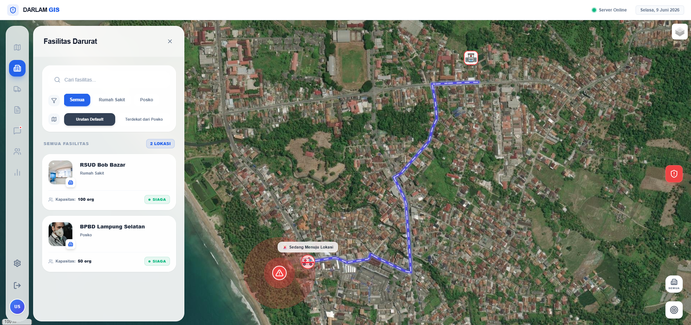
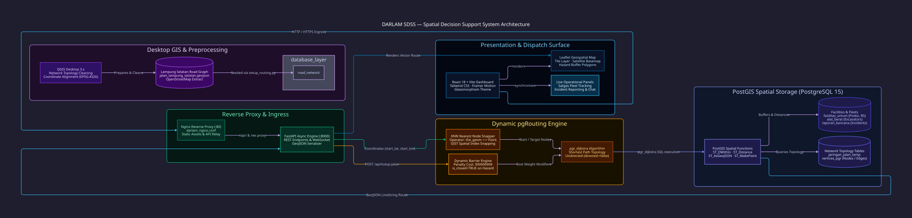
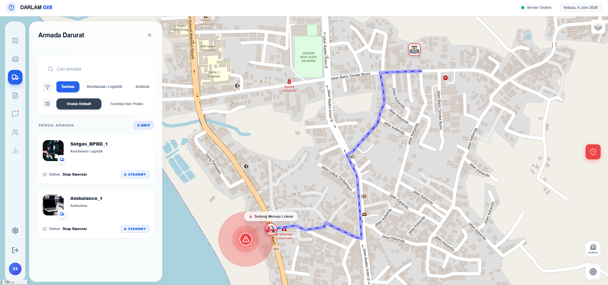
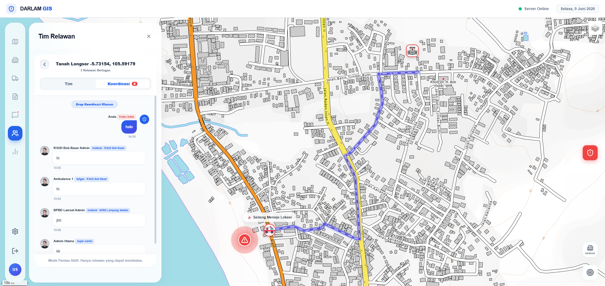
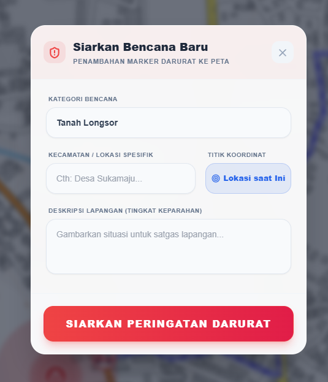

<div align="center">
  <br />
  <h1 align="center">🗺️ DARLAM — Disaster Response GIS</h1>
  <p align="center"><i>SPATIAL DECISION SUPPORT SYSTEM (SDSS) · DYNAMIC PGROUTING & EMERGENCY EVACUATION</i></p>

  <a href="https://github.com/HyLuthfi/disaster-response-gis">
    
  </a>
  <br />

  <p align="center">
    
    
    
    
    
    
    
    
    
    
    
  </p>

  <p align="center" style="max-width: 850px; font-size: 1.05rem; color: #94a3b8; line-height: 1.6;">
    <b>DARLAM SDSS</b> adalah platform Sistem Pendukung Keputusan Spasial (<i>Spatial Decision Support System</i>) berbasis Web GIS terintegrasi yang direkayasa untuk mengoptimalkan operasi tanggap darurat bencana alam. Mengombinasikan database relasional geospasial <b>PostgreSQL/PostGIS</b>, kalkulasi jalur terpendek berbobot dinamis <b>pgRouting (Dijkstra)</b>, backend asynchronous berkecepatan tinggi <b>FastAPI</b>, dan dasbor interaktif <b>React 18 + Leaflet</b>, DARLAM menghitung rute evakuasi warga dan penugasan armada satgas (alat berat, ambulans, logistik) secara adaptif terhadap penutupan jalan akibat longsor atau banjir dengan latensi komputasi di bawah 50ms.
  </p>
</div>

<p align="center">
  
</p>

<p align="center"></p>

## 🏛️ Arsitektur Sistem Geospasial

Sistem dibangun dengan arsitektur komputasi terdistribusi yang memisahkan layer pembersihan data spasial mentah (QGIS), layer komputasi topologi graf jalan raya berkinerja tinggi (PostGIS + pgRouting), layer API microservice (FastAPI), dan antarmuka analitik dispatch (React Leaflet):

<p align="center">
  
</p>

<p align="center"></p>

## ⚡ Fitur Rekayasa Unggulan

<table align="center" width="100%">
  <tr>
    <td width="50%" valign="top">
      <b>🧮 Dynamic Dijkstra Evacuation Routing</b><br/>
      Kalkulasi rute evakuasi tercepat memanfaatkan algoritma Dijkstra tak-berarah (<code>pgr_dijkstra</code>) langsung di level database engine. Titik awal dan koordinat tujuan diselaraskan ke simpul jaringan jalan terdekat (<i>Nearest Node Snapping</i>) menggunakan operator spasial KNN PostGIS <code>&lt;-&gt;</code> berindeks GIST dengan waktu eksekusi <b>&lt;50ms</b>.
    </td>
    <td width="50%" valign="top">
      <b>🚧 Injeksi Penalti Hambatan Bencana Real-Time</b><br/>
      Ketika ruas jalan tertutup material longsor atau genangan banjir, operator BPBD dapat memicu penutupan ruas jalan via endpoint <code>POST /api/tutup-jalan</code>. Sistem secara otomatis menaikkan bobot rute menjadi tak terhingga (<code>cost = 999999999</code>) dan mengisolasi ruas (<code>is_closed = TRUE</code>), memaksa algoritma mencari rute alternatif memutar yang aman.
    </td>
  </tr>
  <tr>
    <td width="50%" valign="top">
      <b>🚛 Manajemen Penugasan Armada Satgas (Dispatch)</b><br/>
      Modul alokasi sumber daya darurat memetakan armada operasional: Excavator, Bulldozer, Dump Truck, Ambulans, dan Tim Evakuasi SAR. Sistem menghitung jarak tempuh aktual mengikuti kontur jalan (bukan garis lurus Euclidean) untuk menugaskan armada terdekat ke lokasi bencana.
    </td>
    <td width="50%" valign="top">
      <b>🗺️ Dasbor Geospasial Multi-Layer (React 18 + Leaflet)</b><br/>
      Antarmuka visual modern dengan basemap satelit ESRI dan OpenStreetMap. Menyajikan polygon buffer radius bahaya bencana, layer fasilitas darurat (Posko Pengungsian, Rumah Sakit, Dapur Umum), marker alat berat aktif, serta visualisasi polyline rute evakuasi beranimasi.
    </td>
  </tr>
  <tr>
    <td width="50%" valign="top">
      <b>📡 Integrasi Data Spasial & Pembersihan Topologi QGIS</b><br/>
      Jaringan jalan raya wilayah Lampung Selatan diekstrak dari OpenStreetMap dan diproses menggunakan QGIS Desktop untuk memastikan konektivitas topologi tanpa celah (*gap/overlap*). Data disimpan ke dalam tabel jaringan graf PostGIS lengkap dengan node sumber (<i>source</i>) dan target (<i>target</i>).
    </td>
    <td width="50%" valign="top">
      <b>💬 Koordinasi Lapangan & Pelaporan Warga Terverifikasi</b><br/>
      Saluran komunikasi real-time untuk koordinasi satgas relawan di lapangan per posko bencana, dilengkapi modul pelaporan insiden darurat oleh masyarakat umum yang melalui alur verifikasi resmi operator sebelum dipublikasikan ke peta situasi.
    </td>
  </tr>
</table>

<p align="center"></p>

## 📸 Galeri Antarmuka Sistem

<table align="center" width="100%">
  <tr>
    <td width="50%" align="center">
      <b>🛰️ Peta Satelit & Perutean Evakuasi Terdekat</b><br/><br/>
      
    </td>
    <td width="50%" align="center">
      <b>🚒 Mode Armada & Radius Geofencing Satgas</b><br/><br/>
      
    </td>
  </tr>
  <tr>
    <td width="50%" align="center">
      <b>💬 Live Chat Koordinasi Lapangan Relawan</b><br/><br/>
      
    </td>
    <td width="50%" align="center">
      <b>📋 Form Pelaporan Bencana & Koordinat GPS</b><br/><br/>
      
    </td>
  </tr>
</table>

<p align="center"></p>

## 🧮 Spesifikasi Topologi Algoritma & Formula Kueri Spasial

### 1. Kueri Node Snapping via Operator KNN Spasial (`<->`)
Menemukan vertex jalan terdekat dari koordinat klik pengguna menggunakan indeks spasial R-Tree (GIST):
```sql
SELECT id FROM jaringan_jalan_temp_vertices_pgr 
ORDER BY the_geom <-> ST_SetSRID(ST_MakePoint(:lon, :lat), 4326) 
LIMIT 1;
```

### 2. Kueri Algoritma Dijkstra Terbobot (`pgr_dijkstra`)
Mengeksekusi perutean graf terisolasi yang mengabaikan ruas jalan tertutup bencana:
```sql
SELECT path.seq, path.node, path.edge, path.cost, 
       ST_AsGeoJSON(j.geom)::json AS geometry
FROM pgr_dijkstra(
    'SELECT id, source, target, cost, reverse_cost FROM jaringan_jalan_temp WHERE is_closed = FALSE',
    :start_node_id, 
    :end_node_id, 
    directed := false
) AS path
LEFT JOIN jaringan_jalan_temp j ON path.edge = j.id
WHERE j.geom IS NOT NULL;
```

### 3. Logika Penutupan Jalan & Penalti Biaya Rute
Menginjeksi penalti tak hingga dan mencatat histori insiden penutupan jalan:
```sql
-- Deteksi jalan terdekat dalam radius bencana
SELECT id, name, highway, 
       ST_Distance(geom::geography, ST_SetSRID(ST_MakePoint(:lon, :lat), 4326)::geography) AS distance_m
FROM jaringan_jalan_temp
WHERE ST_DWithin(geom::geography, ST_SetSRID(ST_MakePoint(:lon, :lat), 4326)::geography, :radius_m)
  AND is_closed = FALSE
ORDER BY distance_m ASC LIMIT 1;

-- Injeksi penalti biaya perutean
UPDATE jaringan_jalan_temp 
SET is_closed = TRUE, cost = 999999999, reverse_cost = 999999999 
WHERE id = :jalan_id;
```

<p align="center"></p>

## 🗃️ Skema Relasional Database Geospasial (PostGIS)

```sql
-- Tabel Jaringan Jalan Topologi Graf pgRouting
CREATE TABLE jaringan_jalan_temp (
    id            BIGSERIAL PRIMARY KEY,
    osm_id        BIGINT,
    name          VARCHAR(255),
    highway       VARCHAR(50),
    source        BIGINT,
    target        BIGINT,
    cost          DOUBLE PRECISION,
    reverse_cost  DOUBLE PRECISION,
    is_closed     BOOLEAN DEFAULT FALSE,
    geom          GEOMETRY(LineString, 4326)
);
CREATE INDEX idx_jaringan_jalan_geom ON jaringan_jalan_temp USING GIST (geom);

-- Tabel Fasilitas Umum Darurat (Posko, RS, Logistik)
CREATE TABLE fasilitas_umum (
    id            SERIAL PRIMARY KEY,
    nama          VARCHAR(255) NOT NULL,
    kategori      VARCHAR(50) NOT NULL, -- 'Posko Evakuasi', 'Rumah Sakit', 'Dapur Umum'
    kapasitas     INTEGER DEFAULT 0,
    tersedia      INTEGER DEFAULT 0,
    geom          GEOMETRY(Point, 4326)
);

-- Tabel Laporan Bencana Publik
CREATE TABLE laporan_bencana (
    id            SERIAL PRIMARY KEY,
    jenis_bencana VARCHAR(100) NOT NULL,
    kecamatan     VARCHAR(100),
    deskripsi     TEXT,
    pelapor       VARCHAR(100),
    kontak        VARCHAR(50),
    status        VARCHAR(50) DEFAULT 'Pending', -- 'Pending', 'Terverifikasi', 'Selesai'
    waktu_laporan TIMESTAMP WITH TIME ZONE DEFAULT CURRENT_TIMESTAMP,
    lokasi_geom   GEOMETRY(Point, 4326)
);
```

<p align="center"></p>

## 📂 Struktur Direktori Repositori

```text
disaster-response-gis/
├── backend/                           # Layanan Backend FastAPI & Spatial Engine
│   ├── main.py                        # Endpoint REST API, router perutean Dijkstra & dispatch
│   ├── requirements.txt               # Dependensi Python (fastapi, uvicorn, psycopg2-binary)
│   ├── .env.example                   # Template konfigurasi variabel lingkungan database PostGIS
│   ├── setup_tables.py                # DDL migration script pembuatan skema tabel PostGIS
│   ├── setup_routing.py               # Pembuat topologi graf pgr_createTopology
│   ├── setup_users.py                 # Pengelola kredensial operator & satgas relawan
│   └── seed_db.py                     # Seeder data awal jalan & fasilitas umum
├── frontend/                          # Antarmuka Pengguna Web GIS (React 18 + Vite)
│   ├── src/
│   │   ├── components/                # Komponen antarmuka Leaflet map, panel laporan, chat
│   │   ├── App.jsx                    # Root state controller aplikasi web
│   │   ├── main.jsx                   # React 18 DOM mount point
│   │   └── index.css                  # Konfigurasi utility Tailwind CSS
│   ├── public/                        # Aset statis favicon & media visual evakuasi
│   ├── package.json                   # Dependensi React, Leaflet, Framer Motion
│   └── vite.config.js                 # Konfigurasi bundler Vite
├── database/                          # Skrip DDL SQL & Dataset Awal
│   ├── schema.sql                     # Skema komprehensif tabel geospasial
│   └── dummy_data.sql                 # Data simulasi armada dan fasilitas umum
├── qgis/                              # Proyek GIS Desktop & Lapisan Geospasial
│   └── jalan_lampung_selatan.geojson  # Ekstrak graf jalan raya OpenStreetMap
├── assets/                            # Kompilasi diagram arsitektur D2 vektor & screenshot
├── docs/                              # Kode sumber diagram arsitektur D2 (architecture.d2)
├── darlam_nginx.conf                  # Konfigurasi reverse proxy Nginx produksi
├── DARLAM_PLAN.md                     # Rencana rekayasa akademis sistem SDSS
└── LICENSE                            # Lisensi Open-Source MIT (Luthfi Muthathohirin)
```

<p align="center"></p>

## 🚀 Panduan Eksekusi & Instalasi Cepat

### 1. Prasyarat Sistem
- **Python**: `v3.11.x`
- **Node.js**: `v18.x` atau lebih baru
- **PostgreSQL 15** dengan ekstensi **PostGIS** dan **pgRouting** aktif
- **QGIS 3.x** *(Opsional, untuk kustomisasi jaringan jalan)*

---

### 2. Konfigurasi Basis Data Geospasial (PostGIS + pgRouting)
Masuk ke terminal PostgreSQL dan aktifkan ekstensi geospasial:
```sql
CREATE DATABASE darlam_db;
\c darlam_db;
CREATE EXTENSION postgis;
CREATE EXTENSION pgrouting;
```

---

### 3. Setup & Menjalankan Backend API (FastAPI)
```bash
cd backend

# Buat dan aktifkan virtual environment Python
python -m venv .venv
# Windows (Git Bash / PowerShell):
source .venv/Scripts/activate
# Linux / macOS:
# source .venv/bin/activate

# Instal dependensi
pip install -r requirements.txt

# Siapkan file environment
cp .env.example .env
# Sesuaikan parameter DB_USER, DB_PASSWORD, dan DB_NAME pada file .env

# Jalankan skrip inisialisasi tabel dan topologi routing
python setup_tables.py
python setup_routing.py
python setup_users.py
python seed_db.py

# Jalankan server API FastAPI
uvicorn main:app --host 127.0.0.1 --port 8000 --reload
```
Akses dokumentasi OpenAPI Swagger di `http://127.0.0.1:8000/docs`.

---

### 4. Menjalankan Frontend Web GIS (React + Vite)
Buka terminal baru di root direktori repositori:
```bash
cd frontend

# Instal dependensi React
npm install

# Jalankan server development Vite
npm run dev
```
Akses dasbor geospasial interaktif di browser pada `http://localhost:5173`.

---

### 5. Deployment Produksi via Nginx
Untuk meng-hosting sistem pada server Linux (VPS / Ubuntu Server), terapkan template `darlam_nginx.conf`:
```bash
sudo cp darlam_nginx.conf /etc/nginx/sites-available/darlam
sudo ln -s /etc/nginx/sites-available/darlam /etc/nginx/sites-enabled/
sudo nginx -t
sudo systemctl reload nginx
```

<p align="center"></p>

## 🛡️ Jaminan Keamanan, Audit & Lisensi

- **Audit Kredensial Bersih (Gitleaks v8.30.1):** Seluruh riwayat repositori telah diaudit secara forensik dan mencatat **0 kebocoran rahasia**.
- **Netralisasi Kredensial Database:** Seluruh parameter koneksi database telah dimigrasikan ke variabel lingkungan (`os.getenv`) dengan fallback dev aman, menghapus seluruh hardcoded credential pada skrip backend maupun skrip deployment.
- **Pembersihan Aset Redundan:** Aset media duplikat telah dibersihkan untuk menjaga performa working tree git.
- **Perlindungan `.gitignore` Hardened:** Menyaring berkas environment (`.env*`), dump database (`*.dump`, `backend/dumps/`), cache QGIS (`*.qgz~`), serta dependensi `node_modules/`.
- **Lisensi Open-Source Sah:** Dilisensikan di bawah ketentuan **MIT License**. Hak cipta dipegang penuh oleh **Luthfi Muthathohirin** (`@HyLuthfi`). Lihat berkas [`LICENSE`](LICENSE) untuk dokumen hukum lengkap.

---

<div align="center">
  <p style="font-size: 0.95rem; color: #64748b;">
    Dirancang & Dibangun oleh <b>Luthfi Muthathohirin</b> (<a href="https://github.com/HyLuthfi">@HyLuthfi</a>)<br/>
    Spatial Decision Support System (SDSS) untuk Mitigasi & Tanggap Darurat Bencana
  </p>
</div>


